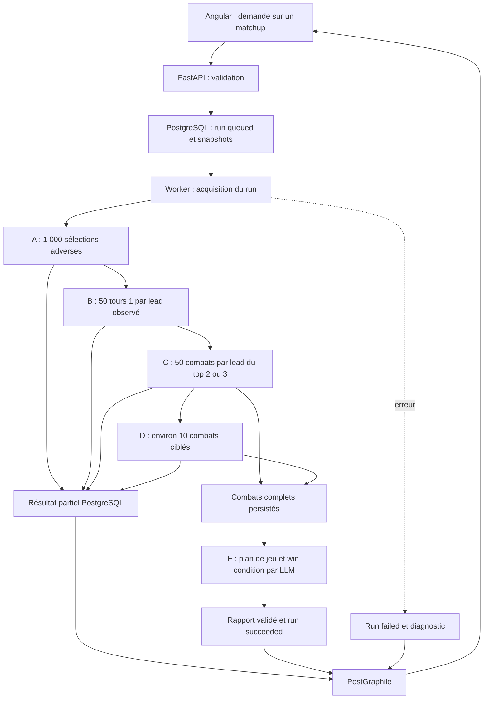

# Workflow Python — Analyse réelle d’un matchup

Statut : spécification du futur traitement et de son implémentation progressive, phase par phase. Aucun moteur réel n’est implémenté par ce document.

Source métier : [synthèse du projet](../../../synthese_projet_vgc_matchup_coach.md), en particulier §3 pour les simulations, §4 pour la synthèse LLM, §5 pour les mesures et §7 pour la traçabilité. La demande plus récente de l’utilisateur précise le fonctionnement : **un matchup à la fois depuis l’interface**, et non une préparation groupée de quinze adversaires.

## 1. Objectif et frontières

À partir d’un matchup déjà enregistré, Python doit produire un rapport permettant de préparer un BO3 : leads adverses observés, premiers tours, back, sélection de notre quatre et de notre lead, recommandations du premier tour, plan de jeu et win condition proposée par le LLM.

Les observations proviennent du checkpoint BC de base de VGC-Bench. Elles décrivent ce modèle dans les conditions de simulation ; elles ne mesurent pas directement les probabilités de décision de joueurs humains. Une validation technique réussie ne prouve pas la qualité stratégique des recommandations.

Les décisions métier A/B/C/D ci-dessous viennent du document source. La dernière demande utilisateur remplace sa répartition des responsabilités : **les points 1 à 4 du rapport sont calculés de manière déterministe et stockés en base ; le LLM reçoit uniquement les parties complètes simulées en C et D et rédige seulement les points 5 et 6**. Les contrats techniques ci-dessous organisent cette demande. Les détails d’adaptation à VGC-Bench restent soumis à l’audit de son code et à des essais réels.

| Composant | Responsabilité |
| --- | --- |
| Angular | Importer les équipes, choisir un matchup, demander une analyse, présenter progression et rapport |
| PostGraphile | Exposer les équipes, matchups, runs et rapports persistés pour la lecture frontend |
| FastAPI | Valider et enregistrer une demande, renvoyer l’identifiant du run |
| Worker Python | Exécuter les phases, agréger, appeler le LLM, persister le résultat |
| PostgreSQL | Source de vérité des demandes, snapshots, statuts, paramètres et rapports |
| VGC-Bench + Showdown local | Produire les décisions et résultats des simulations |
| LangGraph / LLM | À partir des seuls combats complets C/D, rédiger le plan de jeu global et la win condition |

La [route de démonstration](../plans/2026-10-31-02-python-demo-seed.md) réinstalle un jeu fixe complet. Elle ne constitue pas une première version du moteur de simulation et n’analyse pas le matchup sélectionné.

## 2. Déclenchement depuis Angular

Après enregistrement des deux équipes et du matchup par les mutations GraphQL existantes, le frontend pourra appeler :

```http
POST /api-python/matchups/{matchup_id}/analyses
Content-Type: application/json
Idempotency-Key: <UUID créé pour cette demande>

{}
```

Le corps vide utilise une configuration serveur versionnée : checkpoint de base, réglementation du matchup, paramètres A/B/C/D ci-dessous, et vise la dernière phase disponible. Pour la recette incrémentale, accepter aussi `{ "targetPhase": "A", "profile": "smoke" }`. `targetPhase` vaut `A`, `B`, `C`, `D` ou `synthesis` ; une phase non déployée est refusée avec 422. Le profil `standard` utilise les budgets métier ; `smoke`, réservé aux essais techniques, utilise A=20, B=3 par lead, C=3 par lead du top 3, D=2. Le profil et les limites de cet échantillon sont affichés et figés dans le run. Une réglementation absente doit être renseignée avant le lancement ; ne pas la déduire silencieusement des noms des Pokémon.

FastAPI vérifie le matchup, les équipes non archivées, leurs six Pokémon, la réglementation et la disponibilité de la configuration du moteur. Il crée un run `source='simulation'`, `status='queued'`, `process_status='INITIAL'`, avec snapshots et paramètres figés. Il renvoie **202 après commit**, sans attendre les simulations :

```json
{
  "matchupId": "<UUID>",
  "runId": "<UUID>",
  "source": "simulation",
  "status": "queued",
  "processStatus": "INITIAL"
}
```

Même clé et même demande : renvoyer le run existant (202 s’il est en attente ou en cours, 200 s’il est en pause ou terminé). Même clé réutilisée pour une demande différente : 409. Persister les commandes et leur empreinte normalisée, vérifier une clé existante avant de résoudre de nouveaux paramètres serveur. Une nouvelle clé signifie une nouvelle demande ; refuser avec 409 un second run `queued/running` sur le même matchup.

Pour enrichir le **même run en pause**, appeler `POST /api-python/analyses/{run_id}/continue`, avec une nouvelle `Idempotency-Key` et `{ "targetPhase": "B" }`. Le worker démarre à la première phase manquante et conserve tous les résultats précédents. Une cible déjà atteinte, une configuration incompatible ou un run terminal donnent 409 ; une cible non déployée donne 422. Deux continuations concurrentes ne créent pas deux exécutions. La cible peut aller jusqu’à la dernière phase disponible, mais aucune phase intermédiaire n’est sautée.

`GET /api-python/analysis-capabilities` expose les phases réellement déployées, les profils et les formats/checkpoints configurés. Le frontend s’en sert pour afficher les actions disponibles ; le serveur les valide également. Ajouter `POST /api-python/analyses/{run_id}/cancel` pour abandonner un run non terminal. Un run en pause n’empêche pas une nouvelle analyse, mais sa continuation reste soumise à l’absence d’autre run actif du matchup.

Autres réponses : 404 si matchup absent, 409 s’il est archivé ou indisponible, 422 si les données ou la réglementation sont invalides, 503 si la base ou le moteur configuré est indisponible. Les erreurs découvertes après acceptation sont persistées dans le run. Ne pas accepter une analyse en mode mock comme solution de repli implicite.

Angular lit ensuite le run et son résultat partiel par PostGraphile, en conservant le `runId` sélectionné dans l’URL (`?runId=...`). Réutiliser le polling de cinq secondes pour `queued/running`, l’arrêter en pause, à un état terminal ou au départ de la page. Le reprendre après une continuation acceptée. Si le POST a une issue réseau incertaine, réessayer avec la **même** clé. Une ancienne analyse complète reste consultable séparément ; ne pas mélanger ses sections avec celles d’un nouveau run partiel.

## 3. Préparation et exécution durable



Le worker traite une demande persistée et acquiert un verrou ou bail exclusif. Pour le POC, un worker et PostgreSQL suffisent ; aucun broker supplémentaire n’est imposé. Les simulations tournent hors de la boucle HTTP, dans un processus adapté. Un simple `BackgroundTasks` ou `asyncio.create_task` ne garantit pas la reprise après redémarrage ; voir les [limites des tâches en arrière-plan FastAPI](https://fastapi.tiangolo.com/tutorial/background-tasks/).

Avant de jouer, vérifier la compatibilité du checkpoint, des espaces d’action/observation et des équipes avec le format Showdown. Les snapshots font foi même si l’utilisateur édite ensuite une équipe. Le modèle, ses paramètres de sampling et les versions des moteurs sont figés pour le run. L’ajout d’une nouvelle phase au logiciel doit permettre de continuer un run en pause : enregistrer sa version et ses réglages au début de sa première exécution, sans exiger l’égalité du commit applicatif global avec celui de A. Une incompatibilité des paramètres scientifiques déjà figés exige en revanche une nouvelle analyse.

Ne pas garder une transaction SQL ouverte pendant une simulation ou un appel LLM. À chaque fin de phase, persister atomiquement son résultat et l’avancement. Si la cible demandée est atteinte avant `synthesis`, passer en `paused` et libérer le bail ; c’est un arrêt normal pour inspection, pas un succès complet ni une erreur. Une continuation réutilise ces checkpoints de phase.

Prévoir un heartbeat et un délai d’expiration du bail. Un crash au milieu d’une phase fait passer le run en `failed` après expiration, en conservant les phases validées consultables ; il n’est pas repris automatiquement. Ne pas confondre continuation après pause volontaire et reprise d’une simulation interrompue. Un token de bail empêche un ancien worker de publier après expiration, annulation ou réattribution. Les checkpoints déjà validés ne sont jamais réécrits.

## 4. Phase A — Distribution des leads adverses

**Entrée :** nos six Pokémon, les six adverses, format, checkpoint et politique de sampling.

**Budget par défaut : 1 000 simulations valides**, arrêtées dès que la sélection et le lead adverse sont connus. Ne pas jouer une partie entière pour mesurer ce choix si l’adaptateur permet réellement l’arrêt anticipé.

Pour chaque simulation, relever le lead adverse. Agréger les paires sans distinguer leur ordre pour le classement des leads ; conserver séparément l’ordre gauche/droite pour les futures actions et cibles. Identifier les Pokémon par leurs slots dans le snapshot, pas par des noms d’affichage seuls.

Pour chaque lead : effectif, dénominateur de simulations valides, fréquence, rang. Une équipe de six Pokémon offre au maximum quinze paires non ordonnées. Une ligne d’affichage « Autres » n’est pas un lead à simuler en phase B.

La stochasticité doit être réelle et documentée : changer seulement une graine autour d’un argmax déterministe ne produit pas une distribution de décisions. Auditer la politique BC, le sampling, la température éventuelle et les sources d’aléa. Conserver les choix retenus dans les paramètres du run.

**Sortie :** tous les leads observés, triés par fréquence décroissante, avec un départage stable par slots en cas d’égalité.

## 5. Phase B — Tour 1 et back conditionnels au lead

Pour **chaque lead distinct observé en A**, exécuter **50 simulations valides** en imposant ce lead adverse et en laissant le modèle sélectionner les deux Pokémon restants selon sa politique conditionnelle. La façon d’imposer le lead doit être vérifiée dans VGC-Bench ; si un échantillonnage par rejet est nécessaire, compter et mesurer séparément les tentatives rejetées et plafonner leur nombre.

Jouer jusqu’à la résolution du premier tour puis arrêter. Relever :

- Les actions conjointes des deux Pokémon adverses : capacités, cibles, changements, Téracristallisation si disponible.
- Les deux Pokémon du back **choisis au team preview**, avant les changements du tour 1 ; leurs fréquences individuelles et par paire.
- Notre lead et notre tour 1 observés, pour contextualiser les réponses adverses.
- Les résultats observables après le tour 1 : K.-O., PV, statuts, terrain, météo et autres changements pertinents disponibles.

Normaliser les cibles avec le côté du terrain et le slot de l’acteur. Ne pas réunir deux attaques identiques visant des cibles différentes. Définir la politique de sélection de notre côté et la garder traçable : les actions adverses sont conditionnées par les situations rencontrées, pas uniquement par leur lead.

Présenter le tour 1 conjoint le plus fréquent et le back par paire le plus fréquent. Ces deux modes peuvent venir de parties différentes : ne pas les présenter comme une combinaison observée sans compter aussi leur fréquence conjointe. Conserver les alternatives utiles.

**Sortie :** pour chaque lead, distributions d’actions et de backs, effectifs et dénominateurs, contexte de notre lead, quelques exemples courts. Les fréquences marginales de présence des Pokémon du back peuvent totaliser 200 %, car chaque sélection contient deux Pokémon ; les paires totalisent 100 %.

## 6. Phase C — Sélection de nos plans prometteurs

Retenir les **deux ou trois leads adverses les plus fréquents** de A. Proposition de défaut : trois, ou tous les leads disponibles s’il y en a moins. Paramètre enregistré dans le run.

Pour chacun, jouer environ **50 parties complètes** avec son lead imposé. Le back adverse et notre sélection sont échantillonnés selon les politiques enregistrées. Il s’agit de 50 parties au total par lead adverse, **pas de 50 parties pour chacune de toutes nos compositions**.

Pour chaque partie, enregistrer notre quatre, notre lead, notre tour 1, la configuration adverse, l’issue et quelques événements stratégiques. Les compositions ne sont comparées que sur les observations disponibles. Les égalités ne comptent pas comme victoires : publier victoires/défaites/nuls et le taux `victoires / parties terminées`, en précisant la convention. Un timeout ou un combat invalide est un échec technique distinct.

Regrouper nos candidats par paire `(quatre sélectionné, lead sélectionné)` ; présenter leurs effectifs et résultats par lead adverse. Ne pas attribuer un taux nul aux confrontations jamais observées.

**Règle de sélection proposée pour le POC :** parmi les candidats observés contre tous les leads retenus, classer par moyenne des taux de victoire pondérée par les fréquences A renormalisées sur ce top. Départager par l’effectif total, puis par les slots. Si aucun candidat n’a cette couverture, retenir provisoirement celui ayant la meilleure couverture pondérée, puis le meilleur taux pondéré sur ses seules confrontations observées ; signaler clairement le manque de couverture. Aucun seuil ne transforme ce classement en preuve statistique.

Le résultat est un candidat empirique avec ses limites, pas un optimum démontré. Calculer aussi notre tour 1 de manière déterministe : pour le candidat retenu et chaque lead adverse étudié, regrouper les actions conjointes observées dans C, classer par taux de victoire puis effectif, puis clé canonique des actions. Stocker effectifs, victoires/défaites/nuls et règle de classement. Sans observation pour ce candidat et ce lead, afficher « Données insuffisantes » ; ne pas faire compléter ce manque par le LLM. Les justifications sont des textes gabarités à partir des calculs, les alternatives sont les groupes suivants ; aucune adaptation tactique libre n’est inventée.

**Sortie :** notre quatre et notre lead retenus, tableau des candidats observés, taux et effectifs, couverture des leads, tendances et premiers tours associés. Les fréquences A hors top restent visibles dans le rapport.

## 7. Phase D — Évaluation globale de notre sélection

> **Mise à jour novembre 2026 :** voir [plan 11](../plans/2026-11-01-11-phase-d-affinage-global.md). D joue **N combats complets** (budget total 2 en standard/smoke actuel) avec **notre sélection C fixe** et des scénarios adverses tirés sur **tous les leads de A** (poids positifs) et les backs **B** conditionnels. Le bloc `refinement` expose issues, histogramme des scénarios réellement joués et premiers tours observés (dénominateur M ≤ N). Les sections A/C/B restent immuables à la publication.

Le texte ci-dessous décrit l’**ancienne** observation ciblée (lead #1 + back modal) ; il ne reflète plus le comportement implémenté après le plan 11.

Avec notre quatre et notre lead sélectionnés, retenir une configuration adverse : un lead étudié et son back le plus fréquent en B. Proposition de défaut : le lead le plus fréquent de A parmi ceux étudiés en C ; départager les backs ex æquo par leurs slots.

Jouer **environ 10 parties complètes au total** avec les quatre Pokémon et les leads des deux côtés fixés. Les décisions pendant la partie restent celles des politiques BC. Vérifier que l’adaptateur sait imposer à la fois le lead et le back, sans modifier involontairement l’ordre ou les sets.

Collecter les issues, les tours 1, les séquences récurrentes, les Pokémon préservés ou éliminés et quelques exemples de victoire/défaite. Ne pas sélectionner seulement des victoires pour raconter le matchup.

**Sortie :** observations ciblées utiles à la synthèse, identifiants d’exemples et limites de couverture. Dix parties illustrent le plan ; elles ne valident pas statistiquement une win condition. Elles ne représentent pas une simulation complète de l’adaptation entre manches d’un BO3.

Conserver les recommandations de C ; ajouter un bloc d’affinage D, avec résultats et distribution déterministe des tours 1 pour cette configuration exacte. Ne pas fusionner silencieusement ces observations conditionnelles avec les statistiques C. Les historiques normalisés complets des combats C et D, du preview à l’issue, sont conservés séparément du résultat partiel pour la phase LLM.

## 8. Phase E — Plan de jeu et win condition par LangGraph / LLM

`synthesis` est la cinquième étape d’implémentation, après les quatre phases de simulation A/B/C/D. Répartition exclusive du rapport :

| Point du rapport | Producteur | Données persistées |
| --- | --- | --- |
| 1. Leads adverses et fréquences | Calcul déterministe A | Classement, effectifs et dénominateurs |
| 2. Tour 1 adverse et back | Calcul déterministe B | Distributions conditionnelles, actions/cibles et backs |
| 3. Notre quatre et notre lead | Calcul déterministe C | Candidats, règle de classement, sélection et limites |
| 4. Notre premier tour | Calcul déterministe C ; observations D séparées | Actions, cibles, alternatives observées et effectifs |
| 5. Plan de jeu global | LLM | Déroulement, menaces, Pokémon à préserver/éliminer, adaptations |
| 6. Win condition | LLM | Proposition et explication |

**Entrée métier du LLM : uniquement des combats complets simulés en C et D.** Aucun résultat A/B, tableau de fréquences, classement C, recommandation déterministe ni résultat partiel n’est envoyé au modèle. Les instructions système et le schéma de sortie ne sont pas des données de simulation. Chaque combat transporte ses propres métadonnées nécessaires à sa lecture : format, côtés, sets participant au combat, quatre/lead réellement sélectionnés, événements de tous les tours et résultat final.

Pour le POC, sélectionner de manière reproductible un maximum de 12 combats complets : au plus 6 de C et 6 de D, sans remplir artificiellement une phase absente. Échantillonner C sur les leads étudiés et les issues présentes, D sur les issues ; départager par identifiant de simulation. Retenir d’abord les combats C correspondant à notre sélection exacte de D, lorsque disponibles. Ce filtre sert à sélectionner les combats ; son classement et les statistiques de sélection ne sont pas envoyés au LLM. Documenter la couverture réellement obtenue.

Encoder les combats de façon compacte en retirant seulement les messages de protocole redondants, jamais leurs tours intermédiaires ni leur issue. Si le budget d’entrée du modèle est dépassé, retirer des combats entiers : les derniers C sélectionnés d’abord, puis les D surnuméraires, en gardant au moins un D complet pour la configuration ciblée. Ne pas transformer les parties retenues en extraits de premiers tours. Conserver les identifiants, empreintes et raisons d’exclusion. Si même ce D ne tient pas dans le budget, échouer explicitement. Le choix du modèle et du budget est une configuration d’exécution vérifiée lors du plan E.

Le LLM renvoie seulement `gameplan` et `winCondition`, avec les identifiants des combats cités. Il distingue observation et hypothèse, ne crée aucune statistique et ne réécrit pas les points 1 à 4. En cas de contradiction avec notre sélection calculée, conserver cette sélection : le POC ne comporte pas de moteur de vérification stratégique. La synthèse peut être évaluée manuellement.

Valider le schéma de sortie, refuser les champs supplémentaires et les références à des combats non transmis. L’assemblage du rapport final reprend les sections déterministes stockées sans les modifier et ajoute uniquement ces deux champs LLM. Aucun système spécialisé de calcul ou de preuve des win conditions n’est prévu.

Un échec LLM conserve les résultats A–D visibles et fait échouer le run avec un diagnostic. Aucun texte fictif de remplacement. Une relance d’un run terminal constitue une nouvelle analyse ; la réutilisation de résultats d’un run échoué n’est pas requise pour ce premier workflow.

## 9. États, progression et publication du rapport

| Étape | `status` SQL | `process_status` SQL |
| --- | --- | --- |
| Demande enregistrée | `queued` | `INITIAL` |
| A puis B | `running` | `PENDING STATS` |
| C puis D | `running` | `PENDING GAME SIMULATIONS` |
| Synthèse LLM | `running` | `PENDING GAME SIMULATIONS` |
| Cible A/B atteinte | `paused` | `PENDING STATS` |
| Cible C/D atteinte | `paused` | `PENDING GAME SIMULATIONS` |
| Rapport publié | `succeeded` | `SUCCESS` |
| Échec | `failed` | `ERROR` |
| Annulation, si supportée ultérieurement | `cancelled` | `ERROR` |

Conserver l’enum `process_status`, étendre le CHECK de `status` avec `paused`. Ajouter `target_phase`, une progression distincte (`phase`, effectif terminé/cible) et un résultat partiel versionné. Le frontend affiche « En pause après A », « Synthèse du plan de jeu » ou la phase courante ; il ne dépend pas seulement de l’enum générique. GraphQL transforme notamment les espaces des enums en underscores.

`partial_result` est distinct de `report`. Dès A, il contient les sections réellement calculées. À chaque checkpoint, enrichir son contenu sans remplacer les sections validées, incrémenter `result_revision` et enregistrer la phase terminée dans la même transaction. L’UI rend les sections présentes et un état « Pas encore calculé » pour les autres, jamais de faux zéros ou de contenu mock. Un run `failed` peut conserver un résultat partiel consultable.

Écrire dans une seule transaction finale : rapport validé, métadonnées complètes, `finished_at`, `status='succeeded'` et `process_status='SUCCESS'`. En cas d’échec, persister un message contrôlé et les états `failed`/`ERROR` dans une transaction séparée. Une panne DB peut empêcher cette écriture : le mécanisme de récupération du worker doit la résoudre sans prétendre l’avoir déjà enregistrée.

Un run terminal reste immuable ; `paused` est non terminal. `report` reste NULL jusqu’au succès de E ; `finished_at` reste NULL en pause. Le rapport final est égal à la dernière enveloppe partielle devenue complète. Une nouvelle analyse crée un nouveau run ; le rapport précédent et ses snapshots ne sont jamais écrasés par un échec.

## 10. Adaptations nécessaires du système existant

Constats issus du code local au 31 octobre 2026, à revalider avant l’implémentation :

- [Trigger de statut V1.0.6](../../../pokecoach2-conception/modules/1.0-core/sql/core/V1.0.6__add_matchup_run_process_status.sql) : autoriser `running → running`, `running → paused`, `paused → queued` et les sorties d’erreur/annulation. Préserver snapshots figés et runs terminaux immuables. Mettre à jour les contraintes SQL et types Angular, pas seulement l’affichage.
- [Privilèges actuels](../../../pokecoach2-conception/modules/1.0-core/sql/afterMigrate.sql) : auditer l’insertion d’un run avec le rôle worker. La fonction `team_row_to_snapshot_v1` n’a pas de grant worker explicite, et le trigger de snapshot utilise un verrouillage des équipes. Tester l’appel réel et accorder les seuls droits nécessaires, éventuellement via une fonction SQL limitée. Ne pas résoudre cela en utilisant le compte administrateur dans l’API.
- Ajouter les données nécessaires à l’idempotence des commandes, au bail du worker, à la cible, à la progression et aux résultats partiels, avec contraintes et index. Persister les combats complets C/D dans une table séparée ; ils ne sont pas chargés par la requête habituelle du frontend.
- [Mapper Angular](../../../pokecoach2-angular/pokecoach-angular/src/app/core/graphql/coach-mappers.ts) : il accepte actuellement les rapports `source='mock'`, `reportVersion=1`. Introduire un contrat de rapport de simulation et son validateur avant d’activer le moteur réel. Proposition : `source='simulation'`, `reportVersion=2`, avec conservation du lecteur mock v1.
- Fixer l’enveloppe v2 (§14) maintenant et préciser les événements normalisés de combat pendant l’audit du socle. Rendre `Opponent Leads`, `Lead & pick`, `Gameplan` indépendamment, dès que leurs sections sont disponibles. Ne pas exiger un run réussi pour afficher un résultat partiel, ni lui associer les snapshots d’un autre run.
- Mettre à jour la validation SQL du rapport si nécessaire. Ne jamais étiqueter un résultat réel `mock` uniquement pour contourner un validateur.
- Le trigger actuel fige `parameters` et `provenance` dès que le run quitte `queued`. Garder la configuration initiale immuable ; stocker mesures et provenance d’exécution dans un champ distinct `execution_metadata` alimenté par phase. La cible de continuation n’est pas un paramètre scientifique modifiable : elle est dans `target_phase`.

Ces adaptations concernent le futur moteur. La route de réinstallation de seed n’a pas besoin de simuler des transitions `queued/running` ni de résoudre toute cette infrastructure dès maintenant.

## 11. Traçabilité, erreurs et mesures

Pour chaque run, conserver : identifiant, dates, réglementation, snapshots complets des équipes, identifiant et empreinte du checkpoint, commits VGC-Bench/Showdown, version de l’adaptateur, paramètres de sampling et graines, budgets demandés et effectifs réellement obtenus par phase, distributions et résultats, version du rapport, version du prompt et de LangGraph, fournisseur/modèle LLM et paramètres pertinents.

Les agrégats et métadonnées appartiennent à PostgreSQL. Persister les combats complets C/D normalisés dans `core.matchup_run_battles` avec phase, identifiant de simulation, issue, empreinte et version de format ; ne pas les inclure dans la ligne du run ou ses requêtes frontend. Les traces A/B utiles au contrôle restent des artefacts locaux identifiés par run et empreinte. Aucun MinIO. Le LLM ne reçoit que la sélection de combats complets décrite au §8.

Compter séparément tentatives, simulations valides, erreurs techniques et retries. Un budget vise des simulations valides ; les tentatives maximales et délais sont bornés et configurés après les premières mesures. Si le budget n’est pas atteignable, échouer avec la phase, les effectifs obtenus et les causes. Ne pas annoncer 1 000 observations après 900 résultats et 100 erreurs.

Mesurer les durées du preview, du tour 1 et des combats complets, le débit, CPU/RAM/GPU, les temps de démarrage, la durée LLM et l’effet de la parallélisation. Ne pas promettre une durée avant ces mesures. Les fréquences B sont conditionnelles à un lead ; les taux C/D dépendent des configurations testées : conserver les dénominateurs associés à chaque statistique.

## 12. Budget de référence et benchmark

Pour `L` leads distincts observés en A et `K` leads retenus en C :

`N = 1 000 + 50 × L + 50 × K + 10`.

Avec six leads observés et deux ou trois retenus : **1 410 à 1 460 simulations valides**. Avec quinze leads observés et trois retenus : 1 910. Les rejets, erreurs et nouvelles tentatives s’ajoutent au coût de calcul ; leur nombre doit être exposé dans les mesures.

Conserver un benchmark d’environ dix matchups, exécutables individuellement. Comparer ultérieurement les checkpoints à équipes, format, versions du moteur, paramètres, budgets et prompt constants autant que possible. Évaluer séparément résultats des simulations, cohérence des plans et utilité réelle pour la préparation compétitive.

## 13. Audit VGC-Bench préalable et critères d’acceptation

Le dépôt de référence indiqué par la synthèse est `https://github.com/cameronangliss/vgc-bench`. Cette spécification ne suppose aucune signature de fonction non vérifiée.

Avant d’implémenter l’adaptateur, démontrer avec des appels réels :

- Chargement du checkpoint BC et compatibilité du format, des espèces, formes, capacités, objets et espaces d’observation/action ; toute incompatibilité est signalée, jamais remplacée silencieusement.
- Injection de deux équipes et sélection correcte des quatre Pokémon.
- Observation et imposition d’un lead, puis d’un quatre complet ; préservation des slots et cibles.
- Arrêt propre au preview et après la résolution du tour 1, avec libération des ressources Showdown.
- Récupération des actions, backs initiaux, issues, événements et exemples de replay.
- Sampling reproductible dans les limites identifiées, puis mesures avant toute parallélisation importante.

Critères de validation du workflow futur :

1. Une demande idempotente crée au plus un run et utilise des snapshots stables.
2. A/B/C/D respectent les volumes et conditions décrits, avec dénominateurs vérifiables.
3. Les agrégats se recoupent avec un échantillon de traces ; les points 1–4 sont reproductibles sans LLM. Le LLM reçoit seulement des combats complets C/D et produit exclusivement les points 5–6.
4. Le rapport réel est persisté, lu via PostGraphile et rendu dans les trois onglets sans recours aux fixtures.
5. Une panne moteur, LLM ou worker produit un état explicite, sans modifier l’ancien rapport réussi.
6. Les durées et ressources sont mesurées ; la qualité stratégique fait l’objet d’une évaluation humaine distincte.
7. Après chaque phase A/B/C/D, le même run peut être consulté en pause puis continué ; les sections antérieures restent identiques après rechargement de la page. Après E, le rapport est complet et le run réussi.

Hors périmètre : scraper, entraînement, remplacement automatique de checkpoint, RL par matchup, bots ladder, moteur spécialisé de win conditions, commercialisation et optimisation d’infrastructure avant mesures.

## 14. Contrat progressif partagé entre SQL, Python et Angular

Enveloppe `SimulationResultV2`, initialisée vide lors de la création d’un run simulation :

```json
{
  "schemaVersion": 2,
  "source": "simulation",
  "completedPhases": [],
  "opponentLeads": null,
  "leadPick": null,
  "refinement": null,
  "gameplan": null,
  "winCondition": null
}
```

- Après A : `completedPhases=["A"]`, `opponentLeads={sampleSize, leads}`. Chaque lead porte `id` canonique par slots triés, `slots`, `count`, et `turn1=null`.
- Après B : `completedPhases=["A","B"]`, chaque `turn1` contient `sampleSize`, distributions d’actions conjointes, backs par paire et marginaux, états de fin de tour et contextes de notre lead. Les champs A sont inchangés.
- Après C : ajouter `leadPick={selection, comparisons, firstTurns, selectionRuleVersion, limitations}`. `selection` porte notre quatre et notre lead ; chaque entrée de `firstTurns` identifie le lead adverse, ses actions/cibles classées et les effectifs, ou un motif d’absence.
- Après D : ajouter `refinement={configuration, sampleSize, outcomes, firstTurns, battleIds, limitations}`. `leadPick` demeure identique ; D décrit une configuration plus ciblée.
- Après E : ajouter `gameplan={opening, midgame, endgame, threats, preserve, eliminate, adaptations, evidenceBattleIds}` et `winCondition={description, rationale, evidenceBattleIds}`. `completedPhases=["A","B","C","D","synthesis"]` et `report` reçoit cette enveloppe complète.

Les phases complétées forment un préfixe strict de l’ordre A/B/C/D/synthesis. Les références aux Pokémon utilisent côté et slot du snapshot (0–5). Les actions normalisées gardent acteur, type, capacité, cibles, remplacement et Téracristallisation si réellement disponibles ; une donnée absente ne devient pas une action inventée. Réutiliser les concepts `PokemonRef`/`BattleAction` du frontend, en étendant explicitement le contrat si un événement réel le nécessite. Les règles de fréquences utilisent des effectifs entiers ; l’arrondi en pourcentage appartient à l’affichage.

La validation Python vérifie chaque section en profondeur ; SQL impose enveloppe, ordre, complétude, cohérence des états et immutabilité. Angular valide le JSON avant mapping et signale un format inconnu. Partager des exemples JSON de contrat dans `pokecoach2-python/contracts/examples/`, consommés aussi par les tests SQL/Angular ; ces exemples de test ne sont jamais injectés en production.

## 15. Ordre d’implémentation et recette de chaque phase

Voir l’[index des plans](../README.md) : adaptations du système (§10), socle transversal, A, B, C, D, puis E. Les deux plans initiaux restent les prérequis d’installation et de démonstration.

La page matchup possède « Lancer jusqu’à… », « Continuer jusqu’à… », « Annuler », un indicateur de phase, le profil de budget et un sélecteur de run. À la fin de chaque plan de phase : démarrer API, worker et frontend, lancer/continuer un vrai run, attendre sa pause, lire ses sections dans les onglets, recharger et vérifier leur persistance. Le profil `smoke` valide le câblage ; lancer ensuite le budget standard prévu par le plan pour mesurer son comportement réel. Les dépendances non encore implémentées restent signalées comme telles.

La fin de E doit aussi être testée sur un run neuf exécuté de A à E sans pause, en plus de la continuation d’un run enrichi au fil du développement. Les tests unitaires peuvent utiliser des adaptateurs contrôlés ; la recette de chaque phase exige un vrai appel au moteur ou au LLM concerné.
